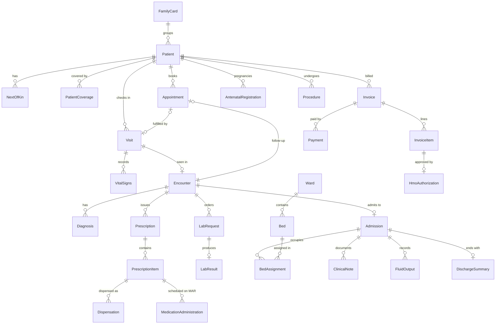

# HealthBridge EMR — Primary Entities

Sources (in `../docs/`):

- **[DA]** *HealthBridge EMR – Data Architecture (24-09-2026).pdf*: the primary source.
- **[PF]** *PRIMARY FEATURES OF THE EMR.pdf*: the feature list. It adds some modules that [DA] doesn't detail.
- **[TPL]** *Data Architecture Template.docx*: an earlier draft. Where it conflicts with [DA], [DA] wins (see [Open questions](#open-questions)).

Guiding principle [DA §8–9]: **one patient = one individual medical record.** Every hospital activity links back to that patient. The *Full Patient Record*, *Patient Timeline* and *Reports* are **views** built from the entities below. They are not separate stores.

Entities marked *(inferred)* aren't named in the docs, but the described workflows need them.

---

## 1. Identity, access & audit

| Entity | Purpose | Key fields / notes |
|---|---|---|
| **User** | A hospital staff member | first name, last name, email (required, unique), phone, role(s), active flag [DA §4.7] |
| **Role** | Doctor, Nurse, Record Officer/Receptionist, Pharmacist, Laboratory Staff, Cashier, HMO Officer, Administrator, other | Configurable [DA §4.7] |
| **Permission** | What a role can *view / create / edit / approve / complete* on each resource | Role ↔ Permission is many-to-many [DA §4.7, §8.30] |
| **AuditLog** | Records important actions: login, registration, record access, encounters, prescriptions, lab, MAR, billing, HMO decisions, admission, bed assignment, discharge | user, action, patient, timestamp, entity type + id of the affected record [DA §4.31]. Append-only. Also records **reads** of patient records ("access history") |

## 2. Patient registry

| Entity | Purpose | Key fields / notes |
|---|---|---|
| **Patient** | The central record, one per person | registration type (New/Returning), **patient category** (FC, PVT, HMO, NHIS/NHIA, Retainership), **hospital number** (unique per person, auto-generated for FC/PVT when not given), title, first/middle/last name, phone (default `+234`), date of birth, gender (M/F), marital status, email, address, country (default Nigeria), occupation, NIN [DA §4.1] |
| **PatientClinicalProfile** | Baseline clinical data | blood group (A±, B±, AB±, O±), genotype (AA, AS, SS, AC, SC, CC), allergies, disabilities [DA §4.2]. Could be columns on Patient; kept separate here because it's clinical data with different access rules |
| **NextOfKin** | Emergency contact(s) | full name, phone (required), address, relationship [DA §4.3]. A patient can have several |
| **FamilyCard** | Groups family members under one FC number | card number. Patient → FamilyCard is many-to-one, optional. **Must never merge medical records** [DA §4.1, §8.2] |
| **PatientCoverage** | The patient's HMO/NHIS/Retainership details | provider name (entered manually for now), member/insurance ID number, category details, active dates [DA §4.1] |
| **HmoProvider** *(inferred)* | List of HMOs and retainership companies | name, type. Needed later for HMO billing, claims and reports [PF §9]. Until then, the provider name stays free text on PatientCoverage |
| **PatientCard** | The physical hospital card | card ID, QR/barcode value, linked to the hospital number, issued/revoked status. Holds **no** clinical data [DA §4.6] |

The duplicate check [DA §4.5] matches on first name, last name, date of birth, phone, NIN and hospital number. These columns need search indexes. It's a behaviour, not a separate entity.

## 3. Scheduling & queue

| Entity | Purpose | Key fields / notes |
|---|---|---|
| **Appointment** | A booked visit | patient, doctor/clinic, date/time, **type** (New Consultation, Follow-up, Review, Procedure, Nursing Service, Medication Administration), status, source encounter (for follow-ups) [DA §4.10–4.11]. Reminders come from [PF §2] |
| **Visit / ClinicalQueueEntry** | A patient's check-in for the day, moving through Record Officer → Nurse → Doctor | patient, **visit type** (Scheduled / Walk-in), appointment (optional), assigned doctor, status (`waiting_vitals → vitals_taken → with_doctor → done`), queued at, queued by [DA §4.8, §4.11]. Due follow-up appointments show up here automatically |
| **ClinicSchedule** *(inferred)* | Doctor/clinic availability | doctor, clinic, day/time slots [PF §2] |

## 4. Outpatient clinical

| Entity | Purpose | Key fields / notes |
|---|---|---|
| **VitalSigns** | Measurements taken by a nurse, from the queue or the ward | patient, visit/admission, recorded by, recorded at, measurements (temperature, BP, pulse, respiratory rate, SpO₂, weight, height, …). **Edits must keep history** [DA §4.9]. Store versions; never overwrite |
| **Encounter** | The doctor's consultation for a visit | patient, visit, doctor, presenting complaint, history, examination, clinical findings, assessment, notes, treatment plan, status (draft/submitted) [DA §4.10] |
| **Diagnosis** | A diagnosis recorded in an encounter | encounter, description/code (ICD-10 later), type (provisional/final) |
| **Prescription** + **PrescriptionItem** | Doctor's medication orders, from an encounter, inpatient orders or discharge (take-home) | item: drug, dose, route, frequency, duration, start date/time, computed quantity. **Context**: outpatient / inpatient / take-home [DA §4.12, §4.24, §4.26] |
| **ClinicalOrder** | Non-medication doctor's orders sent to a department (Pharmacy, Laboratory, Nursing, other) | patient, ordering doctor, target department, details, status [DA §4.24] |
| **Referral** | Referral to another specialist or facility | [PF §3]. Not in [DA] |

## 5. Laboratory & imaging (one "Laboratory Service")

Radiology/imaging is part of Laboratory Service [DA §4.14, §8.9].

| Entity | Purpose | Key fields / notes |
|---|---|---|
| **LabTest** *(catalog)* | Tests and imaging studies offered | name, category (lab/imaging), price, sample type |
| **LabRequest** | One requested test, as a row in the Laboratory Queue | patient (or walk-in details: name, email), test, **source** (Doctor via encounter / Cashier walk-in), requested by, **payment status**, **approval status**, **sample status**, **test status** (Paid → Approved → Sample Collected → Processing → Completed → Result Available) [DA §4.14] |
| **LabResult** | Entered and verified result | request, values/report text, entered by, verified by, doctor reviewed by/at, released-to-patient flag [PF §7] |
| **Attachment** | Uploaded files: imaging, scanned reports, medical documents | owner entity (type + id), patient, file metadata, storage key, uploaded by [PF §10–11] |

## 6. Pharmacy & inventory

| Entity | Purpose | Key fields / notes |
|---|---|---|
| **Drug** *(catalog)* | A medication product | name, form, strength, unit, selling price, reorder level [PF §6] |
| **StockBatch** | Stock held per batch | drug, batch no., quantity on hand, **expiry date**, cost price. Drives the low-stock and expiry alerts |
| **StockMovement** | Inventory ledger | batch, quantity change, reason (receipt/dispense/adjustment/expiry), reference, user |
| **Dispensation** | Pharmacy dispensing a prescription item | prescription item, batch(es), quantity, dispensed by/at, status. **Generates the MAR schedule** for inpatients [DA §4.12–4.13] |

## 7. Inpatient & nursing

| Entity | Purpose | Key fields / notes |
|---|---|---|
| **Ward** | Configurable ward | name, type (General, Male, Female, Pediatric, Maternity) [DA §4.18] |
| **Bed** | Configurable bed in a ward | ward, label/number, status (available/occupied/out of service) |
| **Admission** | One inpatient stay | patient, admitting doctor, source encounter, **type** (Inpatient / Observation / Maternity), **status** (Admitted → Marked for Discharge → Discharged), admitted at, discharged at [DA §4.16–4.17] |
| **BedAssignment** | Patient ↔ bed over time | admission, bed, assigned at, released at, assigned by. Keeping history makes **ward transfers** possible [PF §4] |
| **MedicationAdministration** (MAR / Medication Chart) | Each scheduled or given dose: tablets, injections, IV meds/fluids, blood, other fluids | admission, prescription item (optional, for unprescribed fluids), scheduled time, **actual time given**, **status** (Given / Missed), given by. Nurses cannot change drug/dose/route/frequency/duration [DA §4.12, §4.20] |
| **FluidOutput** | Fluids leaving the patient | admission, type (urine, vomit, drain, other), amount, recorded at, notes, recorded by [DA §4.21] |
| **ClinicalNote** | Nursing notes and doctor's notes/reports. Kept separate by `type`, shown together in Reports | patient, admission/encounter, author, **type** (nursing / doctor / shift handover), body, timestamp [DA §4.22–4.23, PF §5] |
| **NursingAssessment / CarePlan** | Structured nursing documentation | [PF §5]. Not detailed in [DA]; low priority |
| **DischargeSummary** | The doctor's discharge preparation | admission, follow-up instructions, discharge instructions, clinical summary, take-home prescription, prepared by, completed by (nurse), completed at [DA §4.26] |

## 8. Billing, cashier & HMO

HMO work is handled inside Billing/Cashier; there is no separate menu [DA §4.15, §8.10–8.12].

| Entity | Purpose | Key fields / notes |
|---|---|---|
| **ServiceItem** *(catalog, inferred)* | Price list: consultation, procedures, admission/bed charges, other services | code, name, category, price. LabTest and Drug carry their own prices |
| **Invoice** + **InvoiceItem** | Charges for a patient | invoice: patient, visit/admission, status, totals, balance. Item: source entity (lab request, dispensation, procedure, admission, consultation…), description, qty, unit price, **payer** (self/HMO) |
| **Payment** | Money received | invoice, amount, method, received by, received at, receipt number (a receipt is a printable view of a payment) |
| **HmoAuthorization** | HMO Officer's **Approve / Decline** on a requested service for an HMO patient | the request it covers (lab, drug, procedure, imaging, other), coverage, decision, decided by/at, reason. Each department can see the status [DA §4.15] |
| **HmoClaim** | Claims sent to the HMO and their tracking | provider, items, period, status [PF §9]. Not in [DA]; later phase |

**Cross-cutting pattern:** lab requests, prescription items, procedures and services all go through *request → payment or HMO approval → service delivered* [DA §5]. One shared **billable request** status model (`payment_status`, `approval_status`), linked to InvoiceItem and HmoAuthorization, avoids building that gating separately in every department.

## 9. Theatre & procedures

Theatre and procedures have no main-menu entry; they're reached from the patient's workflow [DA §4.29].

| Entity | Purpose | Key fields / notes |
|---|---|---|
| **Procedure** | A surgical or other procedure (C-section, myomectomy, circumcision, …) | patient, encounter/admission, procedure type, surgeon/team, scheduled at, performed at, status |
| **ProcedureNote** | Pre-op assessment, anaesthesia, surgical notes, post-op notes, recovery | procedure, **stage**, author, body [PF §12] |

## 10. Maternal & child health

| Entity | Purpose | Key fields / notes |
|---|---|---|
| **AntenatalRegistration** (Pregnancy) | Booking of an **existing** patient for ANC | patient, booked at/by, husband's name and occupation, past medical history flags (previous operation, hypertension, kidney disease, heart disease, other; default No), family history of twins, current complaints (bleeding, discharge, vomiting, constipation, swelling, other), **LMP**, **EDD (auto-calculated from LMP)** [DA §4.27] |
| **AntenatalVisit** | Each ANC visit | registration, date, findings [PF §13] |
| **DeliveryRecord** | Labour/delivery outcome | pregnancy, admission, date, mode, outcome [PF §13] |
| **Newborn** | Baby record. Ideally registered as its own **Patient**, linked to the mother | [PF §13] |
| **Immunization**, **GrowthMeasurement** | Child health | [PF §13]. Later phase |

## 11. Supporting

| Entity | Purpose |
|---|---|
| **Notification** *(inferred)* | Appointment reminders, low-stock and expiry alerts, live queue updates [PF §2, §6] |
| **Facility / Department** *(inferred)* | Configurable wards, clinics and departments. Also needed if the system ever serves more than one hospital |

---

## Core relationships

Main flow [DA §6]: Registration → Visit/Queue → Vitals → Encounter → Lab / Pharmacy / Procedures → Invoice → HMO approval or payment → Service → Follow-up appointment **or** Admission → Bed → MAR / notes / fluid output → Discharge prep → Marked for discharge → Billing cleared → Nurse completes discharge.

## Derived views (not stored as entities)

- **Full Patient Record**: aggregates biodata, encounters, notes, lab, pharmacy, procedures, admissions, antenatal, invoices/payments, discharges and appointments [DA §4.28].
- **Patient Timeline**: chronological events across all the patient's records [DA §4.25]. It can be built by querying, or from a `PatientEvent` table written alongside each action (simpler and faster to read; to decide).
- **Reports / dashboards**: patient statistics, revenue, bed occupancy, pharmacy, lab, doctor activity, HMO [PF §14].

## Open questions

1. **Hospital number with family cards.** [TPL] says a hospital number "can be shared" under a family card. [DA] says hospital number = one individual and FC number = the family group. **Assumed: [DA] is correct** (unique hospital number per patient, separate FamilyCard).
2. **Genotype values.** [TPL] lists AA/AS/SS; [DA] adds AC/SC/CC. Assumed: [DA].
3. **Roles.** [TPL] lists 5; [DA] lists 9 plus "other authorised users". Assumed: roles are configurable data, not a fixed enum.
4. **City / State / Number of children** are in [TPL] but not [DA]. Include as optional?
5. **HMO name** is entered by hand per patient [DA]. Should we move to a managed `HmoProvider` list so claims and reports group correctly?
6. **Vitals fields.** The exact measurements aren't listed. Need a confirmed set and units.
7. **Diagnosis coding.** Free text or ICD-10?
8. **Walk-in lab patients** without a hospital number: create a minimal Patient, or keep them as non-patient lab clients?
9. **Offline / poor-connectivity support** [DA §3]. This affects ID strategy (client-generated UUIDv7s suit offline sync) and sync/conflict handling, so it should be decided before the schemas are fixed.
